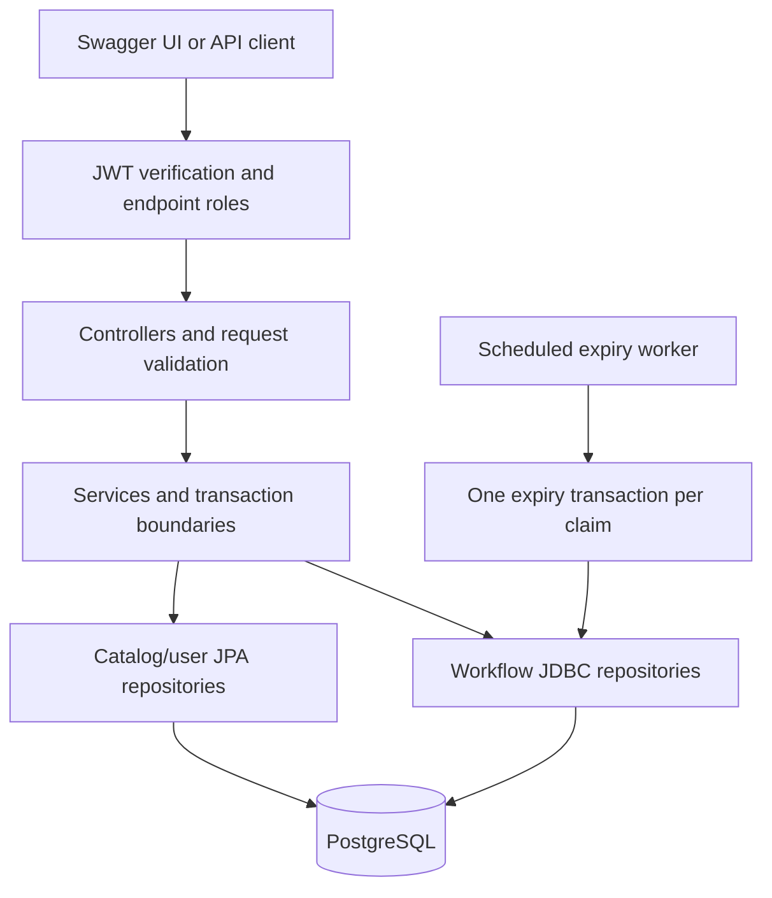
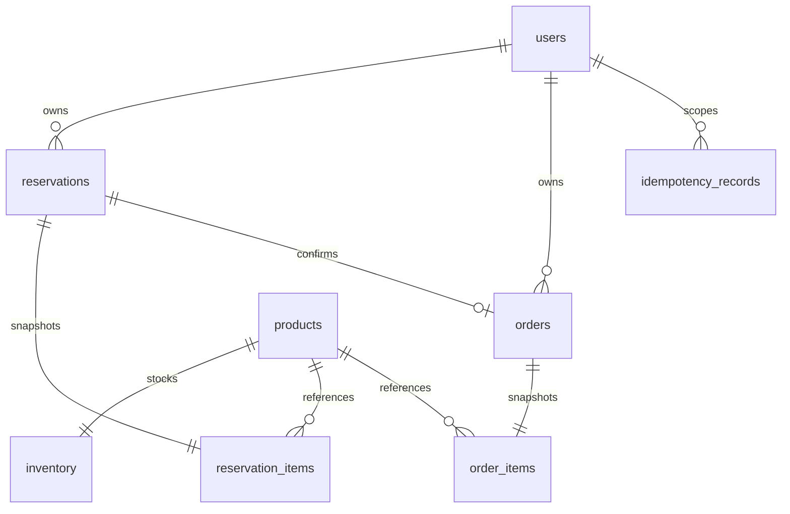

# Architecture and implementation map

StockGuard is a modular monolith with one PostgreSQL source of truth.

## File responsibilities

All paths below are relative to src/main/java/com/example/stockguard unless stated otherwise.

| File(s) | Responsibility |
|---|---|
| common/config/WorkflowConfig.java | UTC Clock, scheduling and validated reservation settings |
| common/config/OpenApiConfig.java | Swagger title, bearer authentication and workflow description |
| common/response/PageResponse.java | Stable list response shape and pagination limits |
| reservation/config/ReservationProperties.java | Validated hold/quantity/pending/batch limits |
| reservation/dto/CreateReservationRequest.java | UUID and whole positive quantity validation |
| reservation/dto/ReservationResponse.java | Reservation snapshot and lifecycle timestamps |
| reservation/repository/ReservationRepository.java | Explicit SQL for locks, stock, reservation storage and due claims |
| reservation/service/ReservationService.java | Reserve/confirm/cancel transactions, ownership, caps, deadlines |
| reservation/service/ExpiryService.java | Claim/release/expire one durable hold atomically |
| reservation/controller/ReservationController.java | Customer and owner HTTP endpoints, replay headers |
| order/dto/OrderResponse.java | Immutable order/item snapshot response |
| order/repository/OrderRepository.java | Order/header-item storage and scoped history queries |
| order/service/OrderService.java | Owner/admin read checks and own-history pagination |
| order/controller/OrderController.java | Order detail/history endpoints |
| idempotency/IdempotencyService.java | SHA-256 request identity, successful response storage/replay |
| idempotency/IdempotentResult.java | Original HTTP status/body and replay indicator |
| infrastructure/scheduler/ReservationExpiryWorker.java | Bounded scheduled batches, failure logging and internal counters |
| resources/db/migration/V3__create_reservations_orders_and_idempotency.sql | Durable workflow schema, constraints and indexes |
| test/.../WorkflowIntegrationTests.java | Real HTTP/PostgreSQL workflow, concurrency and rollback tests |
| .github/workflows/verify.yml (root) | Java 25 build with PostgreSQL-backed tests on GitHub |

## Concurrency and transaction decisions

The implementation uses pessimistic database locks. Existing catalog/users use JPA. Workflow repositories use JdbcTemplate so locking clauses and SKIP LOCKED are visible in the SQL. They share the same DataSource and Spring JpaTransactionManager; JdbcTemplate participates in the transaction. There is no separate database or in-memory authoritative inventory.

Lock order:

- Create: user FOR UPDATE -> product FOR SHARE -> inventory FOR UPDATE.
- Confirm/cancel: user FOR UPDATE -> reservation FOR UPDATE -> inventory FOR UPDATE.
- Expire: reservation FOR UPDATE SKIP LOCKED -> inventory FOR UPDATE; no user lock.
- Stock adjustment: inventory FOR UPDATE.
- Catalog edit: product write lock.

Serializing writes per customer makes the pending cap and idempotency lookup safe across application instances. Product share locks stabilize active status and price while allowing concurrent readers. Inventory locks serialize decisions across distinct customers. Confirm/cancel check the deadline after acquiring inventory, so time spent waiting cannot authorize an expired hold.

The expiry worker never holds inventory locks for multiple reservations in one transaction, avoiding reversed inventory-lock order across workers. Failed transactions roll back lifecycle, stock, order and idempotency records together. Database CHECK/UNIQUE/FK constraints remain a final guard.

Reservation/order item tables currently enforce one item per header. Separate item tables preserve an extension path for a future multi-item contract.

## Relational model

SQL constraints enforce at most one item per header; services create the required item in the same transaction.

## Operational boundaries

- PostgreSQL is required. Docker Compose provides the app and a persistent local database; Testcontainers provides a disposable database for automated tests. Redis remains pending. See [Docker setup](docker.md).
- Worker failures are logged and counted; the next scheduled pass retries durable work. Counters are internal Micrometer meters; only health is currently exposed by Actuator.
- Inspect overdue backlog with: SELECT count(*), min(expires_at) FROM reservations WHERE status='PENDING' AND expires_at <= CURRENT_TIMESTAMP;
- Time-based tests inject Clock; production uses synchronized UTC application clocks.
- No real payment, email verification, token revocation, inventory audit ledger, key-retention cleanup, bot protection or guaranteed fair allocation.
- Deployment and an actual GitHub CI run remain separate delivery steps.

References: [Spring transaction integration](https://docs.spring.io/spring-framework/docs/current/javadoc-api/org/springframework/orm/jpa/JpaTransactionManager.html), [PostgreSQL row locking](https://www.postgresql.org/docs/18/sql-select.html), [springdoc](https://springdoc.org/).
